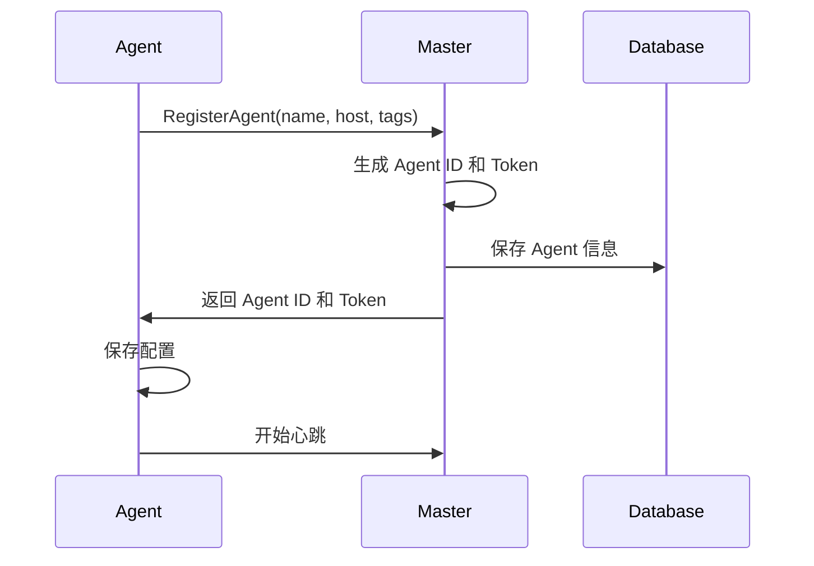
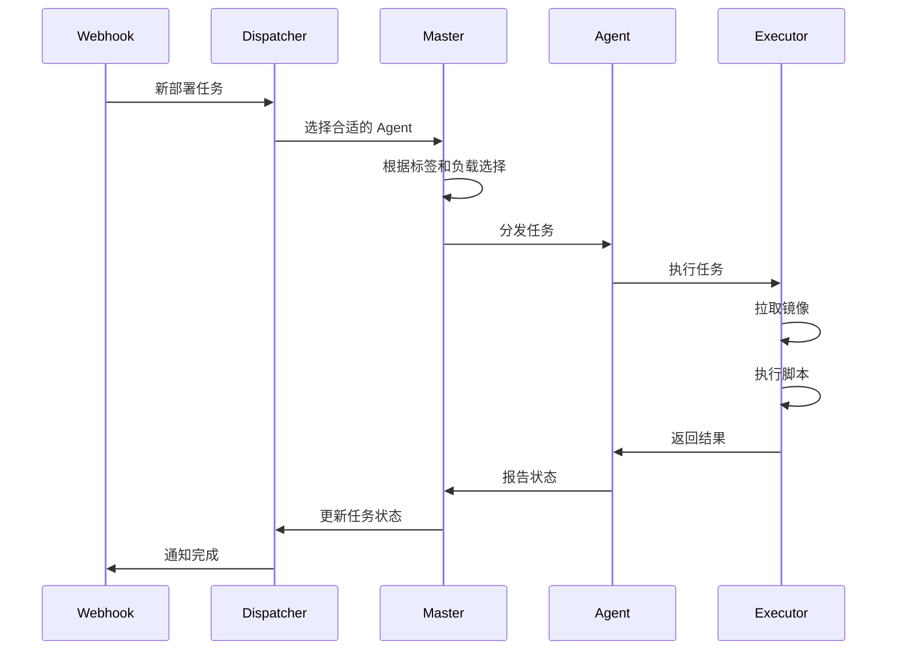
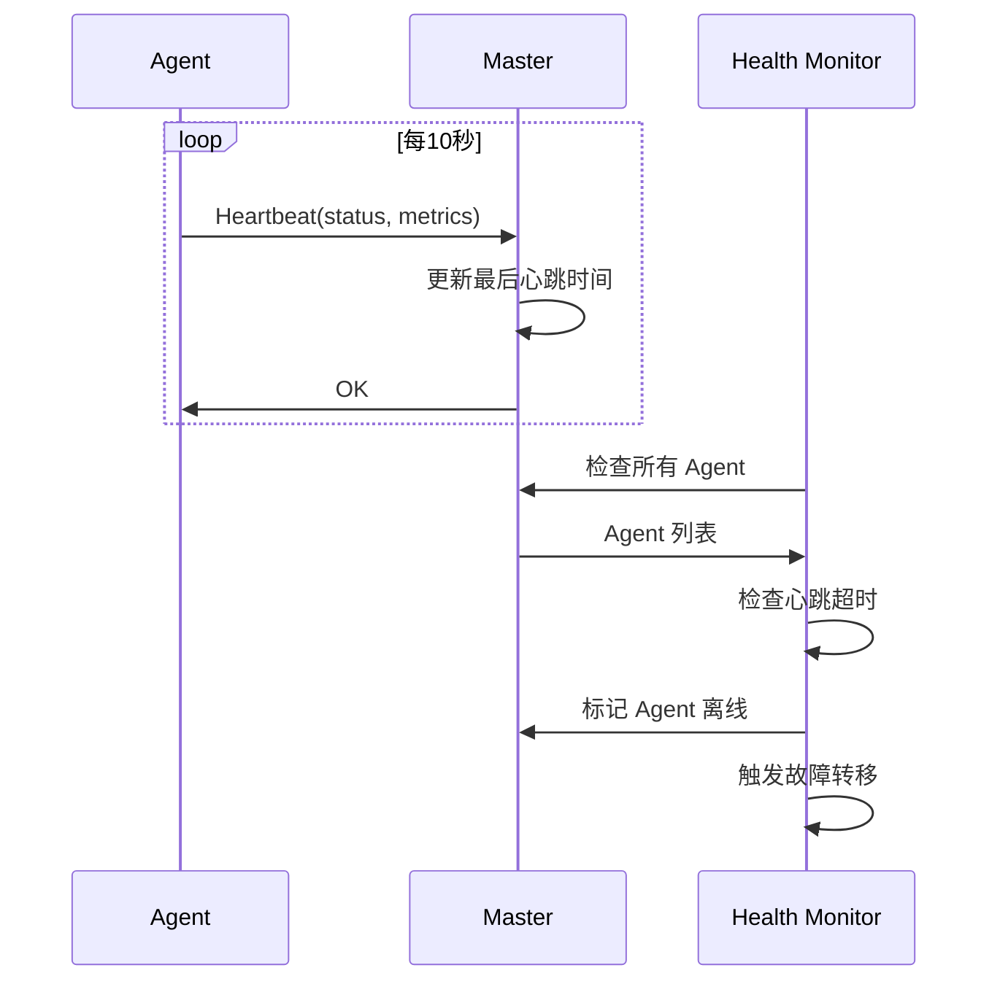

# Dockerun Agent 分布式架构设计文档

> 本文是早期架构设计，保留规划背景，不能将下文目标当作已实现能力。当前 Agent 采用主动连接、绑定节点及固定主机组顺序发布，不自动改派离线任务；实际配置与限制见[一体化操作指南](INTEGRATED_DEPLOYMENT.md#cli-与-agent)。

## 📋 文档信息

- **版本**: v1.0
- **创建日期**: 2025-01-07
- **状态**: 设计阶段
- **相关文档**: [ROADMAP.md](../ROADMAP.md)

---

## 🎯 设计目标

### 核心目标

1. **分布式部署**: 支持在多台机器上部署应用，类似 GitLab + Runner 架构
2. **统一管理**: 通过 Master 节点统一管理所有 Agent 节点
3. **灵活调度**: 支持基于标签的智能任务调度
4. **高可用**: 支持 Agent 节点的健康检查和故障转移
5. **可扩展**: 易于添加新的 Agent 节点

### 非功能性目标

- **性能**: 支持至少 100 个并发 Agent 连接
- **可靠性**: 任务执行失败自动重试
- **安全性**: Agent 与 Master 之间的通信加密
- **可观测性**: 完整的日志和监控

---

## 🏗️ 系统架构

### 整体架构图

```
┌─────────────────────────────────────────────────────────────────┐
│                       Internet / Intranet                        │
└────────────────────────────┬────────────────────────────────────┘
                             │
                             ↓
┌─────────────────────────────────────────────────────────────────┐
│                    Dockerun Master Node                          │
│                                                                  │
│  ┌──────────────┐  ┌──────────────┐  ┌──────────────┐         │
│  │   Web UI     │  │  API Server  │  │   Registry   │         │
│  │  (Frontend)  │  │  (Backend)   │  │  (Optional)  │         │
│  └──────┬───────┘  └──────┬───────┘  └──────────────┘         │
│         │                 │                                      │
│  ┌──────┴─────────────────┴──────────────────────────┐         │
│  │              Core Services                         │         │
│  │  ┌──────────────┐  ┌──────────────┐              │         │
│  │  │   Webhook    │  │   Database   │              │         │
│  │  │   Handler    │  │   (SQLite/   │              │         │
│  │  │              │  │    MySQL)    │              │         │
│  │  └──────────────┘  └──────────────┘              │         │
│  │                                                    │         │
│  │  ┌─────────────────────────────────────────┐     │         │
│  │  │      Agent Management Service           │     │         │
│  │  │  ┌────────────┐  ┌────────────┐        │     │         │
│  │  │  │  Agent     │  │   Task     │        │     │         │
│  │  │  │  Registry  │  │ Dispatcher │        │     │         │
│  │  │  └────────────┘  └────────────┘        │     │         │
│  │  │  ┌────────────┐  ┌────────────┐        │     │         │
│  │  │  │  Health    │  │   Token    │        │     │         │
│  │  │  │  Monitor   │  │  Manager   │        │     │         │
│  │  │  └────────────┘  └────────────┘        │     │         │
│  │  └─────────────────────────────────────────┘     │         │
│  └────────────────────────────────────────────────────┘         │
│                           ↓                                      │
│              ┌──────────────────────────┐                       │
│              │   gRPC / WebSocket       │                       │
│              │   Communication Layer    │                       │
│              └────────────┬─────────────┘                       │
└───────────────────────────┼─────────────────────────────────────┘
                            │
         ┏━━━━━━━━━━━━━━━━━━┻━━━━━━━━━━━━━━━━━━┓
         ↓                  ↓                   ↓
┌────────────────┐  ┌────────────────┐  ┌────────────────┐
│  Agent Node 1  │  │  Agent Node 2  │  │  Agent Node N  │
│                │  │                │  │                │
│  ┌──────────┐  │  │  ┌──────────┐  │  │  ┌──────────┐  │
│  │  Agent   │  │  │  │  Agent   │  │  │  │  Agent   │  │
│  │  Client  │  │  │  │  Client  │  │  │  │  Client  │  │
│  └────┬─────┘  │  │  └────┬─────┘  │  │  └────┬─────┘  │
│       │        │  │       │        │  │       │        │
│  ┌────┴─────┐  │  │  ┌────┴─────┐  │  │  ┌────┴─────┐  │
│  │   Task   │  │  │  │   Task   │  │  │  │   Task   │  │
│  │ Executor │  │  │  │ Executor │  │  │  │ Executor │  │
│  └────┬─────┘  │  │  └────┬─────┘  │  │  └────┬─────┘  │
│       │        │  │       │        │  │       │        │
│  ┌────┴─────┐  │  │  ┌────┴─────┐  │  │  ┌────┴─────┐  │
│  │  Docker  │  │  │  │  Docker  │  │  │  │  Docker  │  │
│  │  Engine  │  │  │  │  Engine  │  │  │  │  Engine  │  │
│  └──────────┘  │  │  └──────────┘  │  │  └──────────┘  │
│                │  │                │  │                │
│  Tags:         │  │  Tags:         │  │  Tags:         │
│  - web         │  │  - database    │  │  - worker      │
│  - frontend    │  │  - backend     │  │  - queue       │
└────────────────┘  └────────────────┘  └────────────────┘
```

---

## 🔧 核心组件设计

### 1. Master 节点

#### 1.1 Agent Registry（Agent 注册中心）

**职责**:
- 管理所有已注册的 Agent
- 维护 Agent 的状态信息
- 处理 Agent 的注册和注销

**数据结构**:

```go
type Agent struct {
    ID          string         `json:"id" gorm:"primaryKey;size:36"`
    Name        string         `json:"name" gorm:"size:200;not null;index"`
    Host        string         `json:"host" gorm:"size:500;not null"`
    Port        int            `json:"port" gorm:"default:9090"`
    Token       string         `json:"token" gorm:"size:200;not null;index"`
    TokenHash   string         `json:"-" gorm:"size:255"` // 加密存储
    
    // 标签和分组
    Tags        string         `json:"tags" gorm:"size:1000"` // JSON 数组
    Labels      string         `json:"labels" gorm:"type:json"` // Key-Value
    Group       string         `json:"group" gorm:"size:100;index"`
    
    // 状态信息
    Status      string         `json:"status" gorm:"size:50;default:offline;index"` // online, offline, busy, error
    LastPing    *time.Time     `json:"last_ping"`
    RegisteredAt time.Time     `json:"registered_at"`
    
    // 容量和负载
    Capacity    int            `json:"capacity" gorm:"default:5"` // 最大并发任务数
    RunningTasks int           `json:"running_tasks" gorm:"default:0"`
    TotalTasks  int            `json:"total_tasks" gorm:"default:0"`
    
    // 系统信息
    OSType      string         `json:"os_type" gorm:"size:50"`
    Architecture string        `json:"architecture" gorm:"size:50"`
    DockerVersion string       `json:"docker_version" gorm:"size:100"`
    CPUCores    int            `json:"cpu_cores"`
    MemoryTotal int64          `json:"memory_total"` // MB
    
    // 配置
    Enabled     bool           `json:"enabled" gorm:"default:true"`
    Description string         `json:"description" gorm:"size:1000"`
    
    CreatedAt   time.Time      `json:"created_at"`
    UpdatedAt   time.Time      `json:"updated_at"`
    DeletedAt   *time.Time     `json:"deleted_at" gorm:"index"`
}

// Agent 标签结构
type AgentTags []string

// Agent 标签（Key-Value）
type AgentLabels map[string]string
```

**API 接口**:

```go
// 注册 Agent
POST /api/agents/register
{
    "name": "web-server-01",
    "host": "192.168.1.100",
    "port": 9090,
    "tags": ["web", "frontend", "production"],
    "labels": {
        "env": "production",
        "region": "us-west"
    },
    "capacity": 5,
    "system_info": {
        "os_type": "linux",
        "architecture": "amd64",
        "docker_version": "24.0.0",
        "cpu_cores": 4,
        "memory_total": 8192
    }
}

// 响应
{
    "agent_id": "agent-uuid-xxxx",
    "token": "secure-token-xxxx",
    "master_config": {
        "heartbeat_interval": 10,
        "task_timeout": 3600
    }
}

// 列出所有 Agent
GET /api/agents

// 获取单个 Agent
GET /api/agents/:id

// 更新 Agent
PUT /api/agents/:id

// 删除 Agent
DELETE /api/agents/:id

// 测试 Agent 连接
POST /api/agents/:id/test
```

#### 1.2 Task Dispatcher（任务分发器）

**职责**:
- 接收部署任务
- 根据策略选择合适的 Agent
- 分发任务到 Agent
- 监控任务执行状态

**任务选择策略**:

```go
type TaskDispatcher struct {
    agents    *AgentRegistry
    queue     chan *DeployTask
    strategy  SelectionStrategy
}

type SelectionStrategy interface {
    SelectAgent(task *DeployTask, agents []*Agent) (*Agent, error)
}

// 策略 1: 标签匹配
type TagMatchStrategy struct{}

func (s *TagMatchStrategy) SelectAgent(task *DeployTask, agents []*Agent) (*Agent, error) {
    // 1. 过滤：匹配所有必需标签的 Agent
    // 2. 排序：按负载从低到高排序
    // 3. 选择：选择负载最低的 Agent
}

// 策略 2: 轮询
type RoundRobinStrategy struct {
    currentIndex int
}

// 策略 3: 最小负载
type LeastLoadStrategy struct{}

// 策略 4: 随机
type RandomStrategy struct{}
```

**任务队列设计**:

```go
type DeployTask struct {
    ID              string            `json:"id"`
    Type            string            `json:"type"` // webhook, manual, scheduled
    Priority        int               `json:"priority"` // 1-10
    
    // Webhook 信息
    WebhookLogID    uint              `json:"webhook_log_id"`
    WebhookConfigID uint              `json:"webhook_config_id"`
    
    // 镜像信息
    ImageName       string            `json:"image_name"`
    ImageTag        string            `json:"image_tag"`
    RegistryID      uint              `json:"registry_id"`
    
    // 部署脚本
    ScriptID        uint              `json:"script_id"`
    ScriptContent   string            `json:"script_content"`
    ScriptFiles     []ScriptFile      `json:"script_files"`
    EnvVars         map[string]string `json:"env_vars"`
    
    // Agent 选择
    TargetAgentID   string            `json:"target_agent_id"` // 指定 Agent
    RequiredTags    []string          `json:"required_tags"`   // 必需标签
    RequiredLabels  map[string]string `json:"required_labels"` // 必需标签
    
    // 状态
    Status          string            `json:"status"` // pending, dispatched, running, success, failed
    AgentID         string            `json:"agent_id"` // 执行的 Agent
    StartedAt       *time.Time        `json:"started_at"`
    CompletedAt     *time.Time        `json:"completed_at"`
    ExecutionTime   int               `json:"execution_time"` // 秒
    
    // 结果
    Output          string            `json:"output"`
    ErrorMessage    string            `json:"error_message"`
    ExitCode        int               `json:"exit_code"`
    
    // 重试
    RetryCount      int               `json:"retry_count"`
    MaxRetries      int               `json:"max_retries" default:"3"`
    
    CreatedAt       time.Time         `json:"created_at"`
    UpdatedAt       time.Time         `json:"updated_at"`
}
```

#### 1.3 Health Monitor（健康监控）

**职责**:
- 定期检查 Agent 心跳
- 标记离线的 Agent
- 触发故障转移

**实现**:

```go
type HealthMonitor struct {
    agents         *AgentRegistry
    checkInterval  time.Duration
    timeout        time.Duration
}

func (h *HealthMonitor) Start() {
    ticker := time.NewTicker(h.checkInterval)
    
    for range ticker.C {
        h.checkAllAgents()
    }
}

func (h *HealthMonitor) checkAllAgents() {
    agents := h.agents.GetAll()
    
    for _, agent := range agents {
        if time.Since(agent.LastPing) > h.timeout {
            h.markAgentOffline(agent)
            h.handleFailover(agent)
        }
    }
}

func (h *HealthMonitor) handleFailover(agent *Agent) {
    // 1. 获取该 Agent 上正在运行的任务
    // 2. 重新分配到其他 Agent
    // 3. 通知任务状态变更
}
```

#### 1.4 Token Manager（令牌管理）

**职责**:
- 生成和验证 Agent Token
- 管理 Token 的生命周期
- 支持 Token 轮换

**实现**:

```go
type TokenManager struct {
    db *gorm.DB
}

type AgentToken struct {
    ID          uint       `json:"id" gorm:"primaryKey"`
    AgentID     string     `json:"agent_id" gorm:"size:36;not null;index"`
    Token       string     `json:"token" gorm:"size:200;uniqueIndex"`
    TokenHash   string     `json:"-" gorm:"size:255"`
    IsActive    bool       `json:"is_active" gorm:"default:true"`
    ExpiresAt   *time.Time `json:"expires_at"`
    LastUsedAt  *time.Time `json:"last_used_at"`
    CreatedAt   time.Time  `json:"created_at"`
}

func (tm *TokenManager) GenerateToken(agentID string) (string, error) {
    // 1. 生成随机 Token
    // 2. 哈希存储
    // 3. 返回原始 Token
}

func (tm *TokenManager) ValidateToken(token string) (*Agent, error) {
    // 1. 查找 Token
    // 2. 验证是否过期
    // 3. 更新最后使用时间
    // 4. 返回关联的 Agent
}
```

---

### 2. Agent 节点

#### 2.1 Agent Client（Agent 客户端）

**职责**:
- 连接到 Master
- 维持心跳
- 接收和执行任务
- 报告任务状态

**实现**:

```go
type AgentClient struct {
    id            string
    config        *AgentConfig
    masterClient  MasterServiceClient
    executor      *TaskExecutor
    status        AgentStatus
    tasks         sync.Map // 当前执行的任务
}

type AgentConfig struct {
    ID            string
    Name          string
    MasterAddr    string
    Token         string
    Tags          []string
    Labels        map[string]string
    Capacity      int
    
    // 通信配置
    HeartbeatInterval time.Duration
    ReconnectInterval time.Duration
    MaxReconnectRetries int
    
    // 执行配置
    WorkDir       string
    LogDir        string
    TempDir       string
}

func (a *AgentClient) Start() error {
    // 1. 连接到 Master
    if err := a.connect(); err != nil {
        return err
    }
    
    // 2. 注册
    if err := a.register(); err != nil {
        return err
    }
    
    // 3. 启动心跳
    go a.heartbeat()
    
    // 4. 监听任务
    go a.listenTasks()
    
    return nil
}

func (a *AgentClient) connect() error {
    // 建立 gRPC 连接
    conn, err := grpc.Dial(
        a.config.MasterAddr,
        grpc.WithTransportCredentials(credentials.NewTLS(&tls.Config{})),
    )
    
    a.masterClient = NewMasterServiceClient(conn)
    return err
}

func (a *AgentClient) heartbeat() {
    ticker := time.NewTicker(a.config.HeartbeatInterval)
    
    for range ticker.C {
        status := a.getStatus()
        
        _, err := a.masterClient.Heartbeat(context.Background(), &HeartbeatRequest{
            AgentID: a.id,
            Status: status,
            RunningTasks: a.getRunningTaskCount(),
        })
        
        if err != nil {
            log.Printf("Heartbeat failed: %v", err)
            a.handleConnectionLoss()
        }
    }
}

func (a *AgentClient) listenTasks() {
    stream, err := a.masterClient.ReceiveTasks(context.Background(), &ReceiveTasksRequest{
        AgentID: a.id,
    })
    
    for {
        task, err := stream.Recv()
        if err != nil {
            log.Printf("Task stream error: %v", err)
            a.handleConnectionLoss()
            return
        }
        
        go a.executeTask(task)
    }
}
```

#### 2.2 Task Executor（任务执行器）

**职责**:
- 执行部署任务
- 管理执行环境
- 收集执行日志
- 报告执行结果

**实现**:

```go
type TaskExecutor struct {
    workDir    string
    dockerCli  *client.Client
    logWriter  io.Writer
}

func (e *TaskExecutor) Execute(task *DeployTask) (*TaskResult, error) {
    // 1. 准备工作目录
    workDir, err := e.prepareWorkDir(task)
    if err != nil {
        return nil, err
    }
    defer e.cleanup(workDir)
    
    // 2. 拉取镜像
    if err := e.pullImage(task); err != nil {
        return nil, err
    }
    
    // 3. 写入脚本文件
    if err := e.writeScriptFiles(task, workDir); err != nil {
        return nil, err
    }
    
    // 4. 执行部署脚本
    result, err := e.executeScript(task, workDir)
    
    return result, err
}

func (e *TaskExecutor) executeScript(task *DeployTask, workDir string) (*TaskResult, error) {
    cmd := exec.Command("/bin/bash", filepath.Join(workDir, "deploy.sh"))
    cmd.Dir = workDir
    cmd.Env = e.buildEnv(task)
    
    var stdout, stderr bytes.Buffer
    cmd.Stdout = io.MultiWriter(&stdout, e.logWriter)
    cmd.Stderr = io.MultiWriter(&stderr, e.logWriter)
    
    startTime := time.Now()
    err := cmd.Run()
    duration := time.Since(startTime)
    
    result := &TaskResult{
        TaskID:        task.ID,
        Success:       err == nil,
        ExitCode:      cmd.ProcessState.ExitCode(),
        Output:        stdout.String(),
        ErrorOutput:   stderr.String(),
        ExecutionTime: int(duration.Seconds()),
    }
    
    return result, nil
}
```

---

### 3. 通信协议

#### 3.1 gRPC Service 定义

```protobuf
syntax = "proto3";

package dockerun.agent.v1;

option go_package = "github.com/dockerun/agent/v1;agentv1";

service MasterService {
    // Agent 注册
    rpc RegisterAgent(RegisterAgentRequest) returns (RegisterAgentResponse);
    
    // 心跳
    rpc Heartbeat(HeartbeatRequest) returns (HeartbeatResponse);
    
    // 接收任务（流式）
    rpc ReceiveTasks(ReceiveTasksRequest) returns (stream Task);
    
    // 报告任务状态
    rpc ReportTaskStatus(TaskStatusReport) returns (TaskStatusResponse);
    
    // 报告任务日志（流式）
    rpc StreamTaskLogs(stream TaskLogChunk) returns (TaskLogResponse);
}

message RegisterAgentRequest {
    string name = 1;
    string host = 2;
    int32 port = 3;
    repeated string tags = 4;
    map<string, string> labels = 5;
    int32 capacity = 6;
    SystemInfo system_info = 7;
}

message SystemInfo {
    string os_type = 1;
    string architecture = 2;
    string docker_version = 3;
    int32 cpu_cores = 4;
    int64 memory_total = 5;
}

message RegisterAgentResponse {
    string agent_id = 1;
    string token = 2;
    MasterConfig config = 3;
}

message MasterConfig {
    int32 heartbeat_interval = 1; // 秒
    int32 task_timeout = 2; // 秒
    int32 max_retries = 3;
}

message HeartbeatRequest {
    string agent_id = 1;
    string status = 2; // online, busy, error
    int32 running_tasks = 3;
    map<string, string> metrics = 4; // CPU, Memory 等
}

message HeartbeatResponse {
    bool success = 1;
    string message = 2;
    repeated string pending_commands = 3; // Master 发送的命令
}

message ReceiveTasksRequest {
    string agent_id = 1;
}

message Task {
    string task_id = 1;
    string type = 2;
    int32 priority = 3;
    
    // 镜像信息
    string image_name = 4;
    string image_tag = 5;
    RegistryAuth registry_auth = 6;
    
    // 脚本信息
    string script_content = 7;
    repeated ScriptFile script_files = 8;
    map<string, string> env_vars = 9;
    
    // 配置
    int32 timeout = 10;
    bool cleanup_on_failure = 11;
}

message RegistryAuth {
    string url = 1;
    string username = 2;
    string password = 3;
}

message ScriptFile {
    string file_name = 1;
    string file_path = 2;
    string content = 3;
    string file_type = 4;
    int32 permissions = 5;
}

message TaskStatusReport {
    string agent_id = 1;
    string task_id = 2;
    string status = 3; // running, success, failed
    int32 exit_code = 4;
    string output = 5;
    string error_message = 6;
    int32 execution_time = 7;
}

message TaskStatusResponse {
    bool success = 1;
    string message = 2;
}

message TaskLogChunk {
    string agent_id = 1;
    string task_id = 2;
    string log_type = 3; // stdout, stderr
    bytes content = 4;
    int64 timestamp = 5;
}

message TaskLogResponse {
    bool success = 1;
}
```

#### 3.2 WebSocket 备选方案

对于不支持 gRPC 的环境，提供 WebSocket 实现：

```go
// WebSocket 消息格式
type WSMessage struct {
    Type    string          `json:"type"` // register, heartbeat, task, status, log
    ID      string          `json:"id"`
    Payload json.RawMessage `json:"payload"`
}

// 示例消息
{
    "type": "task",
    "id": "task-123",
    "payload": {
        "task_id": "task-123",
        "image_name": "myapp",
        "image_tag": "v1.0.0",
        ...
    }
}
```

---

### 4. Webhook 集成

#### 4.1 Webhook 配置扩展

```go
type WebhookConfig struct {
    // ... 原有字段
    
    // Agent 调度配置
    UseAgent         bool              `json:"use_agent" gorm:"default:false"`
    TargetAgentID    string            `json:"target_agent_id" gorm:"size:36"`
    TargetAgentTags  string            `json:"target_agent_tags" gorm:"size:1000"` // JSON 数组
    TargetAgentLabels string           `json:"target_agent_labels" gorm:"type:json"` // JSON 对象
    SelectionStrategy string           `json:"selection_strategy" gorm:"size:50;default:least_load"` // least_load, round_robin, random
    
    // 执行配置
    TaskPriority     int               `json:"task_priority" gorm:"default:5"`
    TaskTimeout      int               `json:"task_timeout" gorm:"default:3600"` // 秒
    MaxRetries       int               `json:"max_retries" gorm:"default:3"`
    RetryOnFailure   bool              `json:"retry_on_failure" gorm:"default:true"`
}
```

#### 4.2 Webhook 处理流程

```go
func (q *TaskQueue) processTask(workerID int, task *DeployTask) {
    // ... 前置步骤（拉取镜像等）
    
    // 检查是否使用 Agent
    if config.UseAgent {
        // 创建 Agent 任务
        agentTask := &AgentDeployTask{
            WebhookLogID: task.WebhookLogID,
            ImageName:    fullImageName,
            ImageTag:     task.ImageTag,
            ScriptID:     config.DeployScriptID,
            TargetAgentID: config.TargetAgentID,
            RequiredTags: parseJSONArray(config.TargetAgentTags),
            RequiredLabels: parseJSONObject(config.TargetAgentLabels),
            Priority:     config.TaskPriority,
            Timeout:      config.TaskTimeout,
            MaxRetries:   config.MaxRetries,
        }
        
        // 分发到 Agent
        err := agentManager.DispatchTask(agentTask)
        if err != nil {
            q.updateLogFailed(task.WebhookLogID, fmt.Sprintf("Failed to dispatch task to agent: %v", err), startTime)
            return
        }
        
        // 异步等待结果
        go q.waitForAgentTaskCompletion(task.WebhookLogID, agentTask.ID)
    } else {
        // 本地执行（原逻辑）
        err := q.executeDeployScript(&config)
    }
}
```

---

### 5. 数据持久化

#### 5.1 数据库表设计

```sql
-- Agent 表
CREATE TABLE agents (
    id VARCHAR(36) PRIMARY KEY,
    name VARCHAR(200) NOT NULL,
    host VARCHAR(500) NOT NULL,
    port INT DEFAULT 9090,
    token_hash VARCHAR(255) NOT NULL,
    tags TEXT,
    labels JSON,
    group_name VARCHAR(100),
    status VARCHAR(50) DEFAULT 'offline',
    last_ping TIMESTAMP,
    registered_at TIMESTAMP NOT NULL,
    capacity INT DEFAULT 5,
    running_tasks INT DEFAULT 0,
    total_tasks INT DEFAULT 0,
    os_type VARCHAR(50),
    architecture VARCHAR(50),
    docker_version VARCHAR(100),
    cpu_cores INT,
    memory_total BIGINT,
    enabled BOOLEAN DEFAULT TRUE,
    description TEXT,
    created_at TIMESTAMP NOT NULL,
    updated_at TIMESTAMP NOT NULL,
    deleted_at TIMESTAMP,
    INDEX idx_name (name),
    INDEX idx_status (status),
    INDEX idx_group (group_name),
    INDEX idx_deleted (deleted_at)
);

-- Agent Token 表
CREATE TABLE agent_tokens (
    id BIGINT AUTO_INCREMENT PRIMARY KEY,
    agent_id VARCHAR(36) NOT NULL,
    token VARCHAR(200) UNIQUE NOT NULL,
    token_hash VARCHAR(255) NOT NULL,
    is_active BOOLEAN DEFAULT TRUE,
    expires_at TIMESTAMP,
    last_used_at TIMESTAMP,
    created_at TIMESTAMP NOT NULL,
    INDEX idx_agent (agent_id),
    INDEX idx_token (token),
    FOREIGN KEY (agent_id) REFERENCES agents(id) ON DELETE CASCADE
);

-- Agent 任务表
CREATE TABLE agent_tasks (
    id VARCHAR(36) PRIMARY KEY,
    type VARCHAR(50) NOT NULL,
    priority INT DEFAULT 5,
    webhook_log_id BIGINT,
    webhook_config_id BIGINT,
    image_name VARCHAR(500) NOT NULL,
    image_tag VARCHAR(100),
    registry_id BIGINT,
    script_id BIGINT,
    script_content TEXT,
    env_vars JSON,
    target_agent_id VARCHAR(36),
    required_tags JSON,
    required_labels JSON,
    agent_id VARCHAR(36),
    status VARCHAR(50) DEFAULT 'pending',
    started_at TIMESTAMP,
    completed_at TIMESTAMP,
    execution_time INT DEFAULT 0,
    output TEXT,
    error_message TEXT,
    exit_code INT,
    retry_count INT DEFAULT 0,
    max_retries INT DEFAULT 3,
    created_at TIMESTAMP NOT NULL,
    updated_at TIMESTAMP NOT NULL,
    INDEX idx_status (status),
    INDEX idx_agent (agent_id),
    INDEX idx_webhook_log (webhook_log_id),
    INDEX idx_created (created_at),
    FOREIGN KEY (agent_id) REFERENCES agents(id) ON DELETE SET NULL
);

-- Agent 任务日志表
CREATE TABLE agent_task_logs (
    id BIGINT AUTO_INCREMENT PRIMARY KEY,
    task_id VARCHAR(36) NOT NULL,
    log_type VARCHAR(50) NOT NULL,
    content TEXT,
    timestamp BIGINT NOT NULL,
    created_at TIMESTAMP NOT NULL,
    INDEX idx_task (task_id),
    INDEX idx_timestamp (timestamp),
    FOREIGN KEY (task_id) REFERENCES agent_tasks(id) ON DELETE CASCADE
);
```

---

### 6. 安全设计

#### 6.1 认证机制

**Token 生成**:
```go
func GenerateAgentToken() (string, string, error) {
    // 生成 32 字节随机 Token
    tokenBytes := make([]byte, 32)
    if _, err := rand.Read(tokenBytes); err != nil {
        return "", "", err
    }
    
    // Base64 编码
    token := base64.URLEncoding.EncodeToString(tokenBytes)
    
    // 使用 bcrypt 哈希
    hash, err := bcrypt.GenerateFromPassword([]byte(token), bcrypt.DefaultCost)
    if err != nil {
        return "", "", err
    }
    
    return token, string(hash), nil
}
```

**Token 验证**:
```go
func ValidateAgentToken(token, hash string) bool {
    err := bcrypt.CompareHashAndPassword([]byte(hash), []byte(token))
    return err == nil
}
```

#### 6.2 通信加密

**TLS 配置**:
```go
// Master 端
creds, err := credentials.NewServerTLSFromFile(
    "server.crt",
    "server.key",
)
server := grpc.NewServer(grpc.Creds(creds))

// Agent 端
creds, err := credentials.NewClientTLSFromFile(
    "ca.crt",
    "master.example.com",
)
conn, err := grpc.Dial(
    masterAddr,
    grpc.WithTransportCredentials(creds),
)
```

#### 6.3 权限控制

```go
type AgentPermissions struct {
    CanPullFromRegistry bool
    CanAccessDockerSocket bool
    AllowedNetworks []string
    AllowedVolumes []string
    MaxCPU float64
    MaxMemory int64
}
```

---

### 7. 监控和日志

#### 7.1 指标收集

**Agent 指标**:
```go
type AgentMetrics struct {
    AgentID         string
    CPUUsage        float64  // 百分比
    MemoryUsage     int64    // MB
    DiskUsage       int64    // MB
    NetworkIn       int64    // Bytes
    NetworkOut      int64    // Bytes
    RunningTasks    int
    CompletedTasks  int
    FailedTasks     int
    Timestamp       time.Time
}
```

**任务指标**:
```go
type TaskMetrics struct {
    TaskID          string
    Status          string
    ExecutionTime   int      // 秒
    ImagePullTime   int      // 秒
    ScriptRunTime   int      // 秒
    CPUPeak         float64
    MemoryPeak      int64
    Timestamp       time.Time
}
```

#### 7.2 日志管理

**日志级别**:
- DEBUG: 详细调试信息
- INFO: 一般信息
- WARN: 警告信息
- ERROR: 错误信息

**日志结构**:
```json
{
    "timestamp": "2025-01-07T10:00:00Z",
    "level": "INFO",
    "component": "agent-client",
    "agent_id": "agent-001",
    "task_id": "task-123",
    "message": "Task execution started",
    "metadata": {
        "image": "myapp:v1.0.0",
        "script": "deploy.sh"
    }
}
```

---

## 🔄 工作流程

### 1. Agent 注册流程



### 2. 任务执行流程



### 3. 健康检查流程



---

## 📊 性能和扩展性

### 性能指标

- **Agent 连接数**: 支持至少 100 个并发连接
- **任务吞吐量**: 每秒处理至少 50 个任务
- **心跳延迟**: < 1 秒
- **任务分发延迟**: < 100ms
- **日志传输**: 支持实时流式传输

### 扩展性设计

1. **水平扩展**: Master 节点支持集群部署
2. **垂直扩展**: Agent 节点可根据负载动态调整容量
3. **任务队列**: 使用消息队列（Redis/RabbitMQ）支持大规模任务
4. **数据分片**: 支持数据库读写分离和分片

---

## 🔮 未来扩展

### Phase 1: 基础功能（v1.0）
- ✅ Agent 注册和管理
- ✅ 基于标签的任务调度
- ✅ 任务执行和状态报告
- ✅ 健康检查和故障转移

### Phase 2: 增强功能（v1.1）
- ⏳ 实时日志流式传输
- ⏳ 任务执行历史和统计
- ⏳ Agent 分组管理
- ⏳ 自动扩缩容

### Phase 3: 高级功能（v2.0）
- ⏳ Master 集群和高可用
- ⏳ 多租户支持
- ⏳ 细粒度权限控制
- ⏳ 插件系统

### Phase 4: 企业功能（v2.1）
- ⏳ LDAP/SSO 集成
- ⏳ 审计日志
- ⏳ 合规性报告
- ⏳ SLA 监控

---

## 📚 相关文档

- [ROADMAP.md](../ROADMAP.md) - 开发路线图
- [当前接口摘要](INTEGRATED_DEPLOYMENT.md#api-摘要) - 已实现接口及其行为
- [DEPLOYMENT.md](./DEPLOYMENT.md) - 部署指南
- [SECURITY.md](./SECURITY.md) - 安全指南

---

## 🤝 贡献

欢迎提出建议和改进意见！

## 📄 许可证

[Apache License, Version 2.0](../LICENSE)

